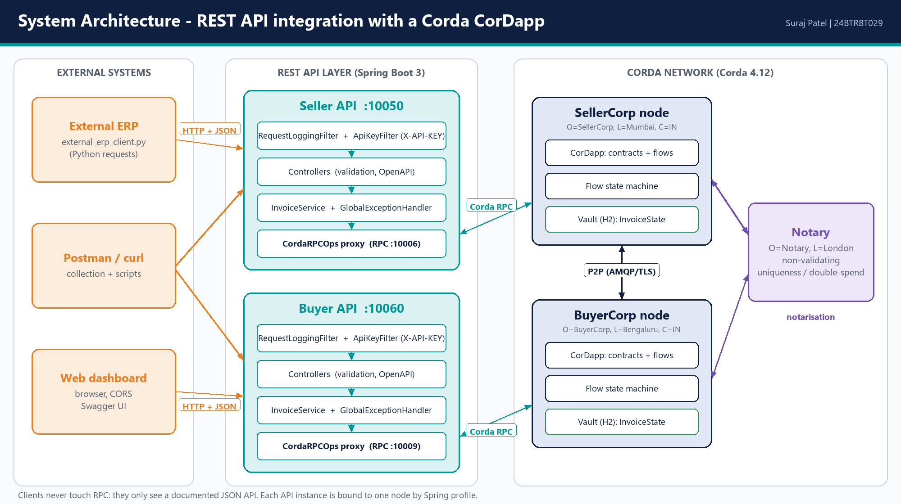
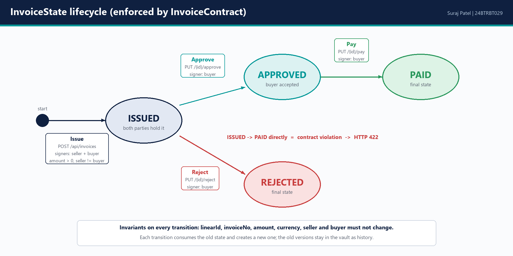
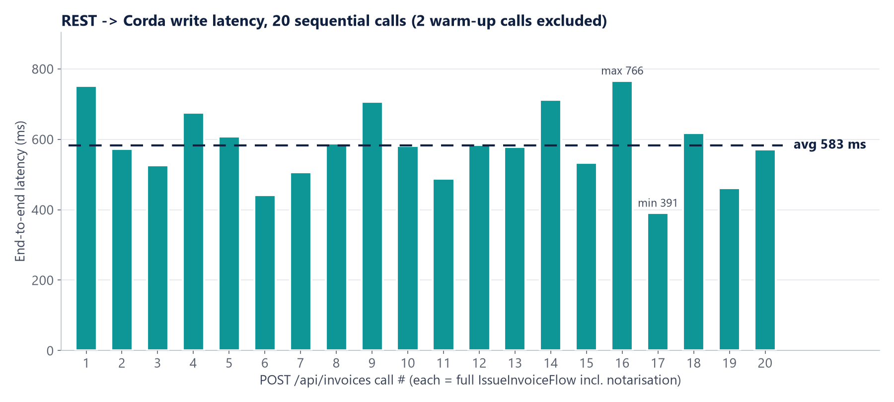

# Corda REST API Integration – Invoice CorDapp

**Topic 25 (Module M5): Implementation of an External REST API Integration with a Corda CorDapp**
Corda Development · B.Tech CSE (Blockchain Technology), Semester V · Jain (Deemed-to-be University)
**Author:** Suraj Patel · USN **24BTRBT029**

This project puts a production-style **Spring Boot 3 REST API** in front of a **Corda 4.12** CorDapp so that
outside systems (an ERP, a web dashboard, Postman, curl) can issue, approve, pay and reject invoices on a
permissioned ledger with plain JSON over HTTP. They never need to know about Corda RPC, flows or vault queries.



## What is inside

| Folder | Content |
|---|---|
| `contracts/` | `InvoiceState` (LinearState), `InvoiceStatus`, `InvoiceContract` (Issue / Approve / Pay / Reject) + 15 ledger-DSL tests |
| `workflows/` | `IssueInvoiceFlow`, `ApproveInvoiceFlow`, `PayInvoiceFlow`, `RejectInvoiceFlow` + responders, 6 MockNetwork tests |
| `clients/webserver/` | Spring Boot 3 REST API (Gradle project `:webserver`): RPC connection, API-key filter, validation, global error mapping, CORS, OpenAPI/Swagger, request logging + 21 MockMvc tests |
| `external_erp_client.py` | Python "outside ERP" that drives both APIs, including the error cases |
| `postman/` | Postman collection (18 requests with tests) |
| `scripts/` | `start_network.ps1`, `stop_network.ps1`, `api_demo.sh` / `.ps1` (curl walk-through), `latency_benchmark.py` |
| `evidence/` | test results, node start-up, ERP client run, curl responses, latency numbers, screenshots |
| `docs/diagrams/` | architecture, sequence, state lifecycle, endpoint map, latency chart |
| `tools/` | generators for the diagrams and evidence images |

## Use case

SellerCorp (Mumbai) issues an invoice to BuyerCorp (Bengaluru). Both sign it, a Notary notarises it, and both
vaults hold the same copy. BuyerCorp then **approves** it and **pays** it, or **rejects** it. Each step is a
Corda transaction that consumes the previous version, so the full audit trail stays on the ledger.



| Command | Transition | Required signers | Extra rules |
|---|---|---|---|
| Issue | – → ISSUED | seller **and** buyer | no input, amount > 0, seller ≠ buyer |
| Approve | ISSUED → APPROVED | buyer | invoiceNo / amount / currency / parties / linearId unchanged |
| Pay | APPROVED → PAID | buyer | same invariants |
| Reject | ISSUED → REJECTED | buyer | same invariants |

## REST endpoints

All responses use one envelope: `{ "success", "data", "error": {status, code, message, details}, "timestamp" }`.
Every `/api/**` call except `/api/health` needs the header `X-API-KEY`.

| Method | Path | What it does | Corda call |
|---|---|---|---|
| GET | `/api/health` | liveness + RPC check (public) | `currentNodeTime()` |
| GET | `/api/me` | node identity | `nodeInfo()` |
| GET | `/api/peers` | other business nodes | `networkMapSnapshot()` |
| GET | `/api/notaries` | notaries | `notaryIdentities()` |
| POST | `/api/invoices` | issue → **201** `{txHash, linearId, invoice}` | `IssueInvoiceFlow` |
| GET | `/api/invoices?status=` | list unconsumed invoices | `vaultQueryBy` |
| GET | `/api/invoices/{linearId}` | one invoice | `LinearStateQueryCriteria` |
| PUT | `/api/invoices/{linearId}/approve` | body `{remarks}` | `ApproveInvoiceFlow` |
| PUT | `/api/invoices/{linearId}/pay` | body `{remarks}` | `PayInvoiceFlow` |
| PUT | `/api/invoices/{linearId}/reject` | body `{remarks}` | `RejectInvoiceFlow` |
| GET | `/api/invoices/{linearId}/history` | every consumed + unconsumed version | `vaultQueryBy(ALL)` |

**Status codes:** 200/201 success · 400 validation / bad UUID / unknown buyer · 401 missing or wrong API key ·
404 unknown linearId · 422 flow or contract rejected the request · 503 node unreachable · 504 flow timeout.

Swagger UI: `http://localhost:10050/swagger-ui.html` (seller) and `http://localhost:10060/swagger-ui.html` (buyer).

## Network

| Node | X.500 name | P2P | RPC | RPC user | REST API | API key |
|---|---|---|---|---|---|---|
| Notary | O=Notary,L=London,C=GB | 10002 | 10003 | – | – | – |
| SellerCorp | O=SellerCorp,L=Mumbai,C=IN | 10005 | 10006 | sellerUser / sellerPass | :10050 | `seller-secret-key-123` |
| BuyerCorp | O=BuyerCorp,L=Bengaluru,C=IN | 10008 | 10009 | buyerUser / buyerPass | :10060 | `buyer-secret-key-456` |

The webserver chooses its node through a Spring profile (`--spring.profiles.active=seller|buyer`) or through
`--config.rpc.host/port/username/password` command-line arguments.
*(These are development credentials for a local demo network. Change them before using this anywhere else.)*

## Requirements

* JDK 17 (tested with Temurin 17.0.20; Azul Zulu 17 also works). The Gradle 7.6 wrapper is included.
* Python 3.9+ with `requests` for the ERP client and benchmark.
* Windows PowerShell for the start/stop scripts (on Linux/macOS, start each node with `java -jar corda.jar`).

## Run it

```powershell
# 1. build + test everything (contracts, flows, REST API)
.\gradlew.bat test

# 2. create the 3-node network and the webserver launch file
.\gradlew.bat deployNodes :webserver:writeLaunchArgs

# 3. start Notary, SellerCorp, BuyerCorp headless + both REST APIs (waits for "started up" and /api/health)
.\scripts\start_network.ps1
#    If the drive is more than 90 % full, Artemis inside each node blocks all messages.
#    In that case run the nodes from another drive:
.\scripts\start_network.ps1 -NodesDir D:\corda-rest-api-run\nodes

# 4. act as an external ERP system
python external_erp_client.py          # writes evidence/erp_client_run.txt
bash scripts/api_demo.sh               # curl walk-through (or .\scripts\api_demo.ps1)
python scripts/latency_benchmark.py    # 20 x POST /api/invoices

# 5. stop everything
.\scripts\stop_network.ps1
```

You can also run a single API from Gradle: `.\gradlew.bat :webserver:runSellerServer` / `:webserver:runBuyerServer`.

## Results (from `evidence/`)

* **Tests:** 42 / 42 passing: 15 contract, 6 flow (MockNetwork), 21 REST API (MockMvc with a mocked `CordaRPCOps`).
* **ERP client:** issued 3 invoices, approved + paid one, approved one, rejected one; showed 401, 400, 422 and 404;
  both vaults ended up identical (`evidence/erp_client_run.txt`).
* **Latency** (20 sequential `POST /api/invoices`, local network, laptop): average **583 ms**, min 391 ms,
  max 766 ms. A read (`GET /api/invoices`) averages **78 ms**.



## Design notes

* The API talks to Corda **only through `CordaRPCOps`**: reads are vault queries and writes are `startFlowDynamic`.
  `InvoiceService` waits for the flow result with a timeout and turns Corda exceptions into typed API errors.
* Transition flows look the invoice up by **linearId**, check the caller is the buyer and that the status is
  right (so the error message is clear), and the contract enforces the same rules again on every node.
* The API is stateless, so more instances per node can sit behind a load balancer.
* Webservers run from the Gradle runtime classpath (`@argfile`) rather than a Spring Boot fat jar, which keeps
  Corda's classpath scanning for CorDapp classes happy.

## Future scope

OAuth2 / JWT per user instead of a shared API key · webhooks or Kafka events from vault updates
(`vaultTrackBy`) so ERPs don't have to poll · idempotency keys on POST · pagination · Docker Compose deployment.

## References

* Corda 4.12 documentation – https://docs.r3.com/en/platform/corda/4.12/community.html
* R3 CorDapp template (Java) – https://github.com/corda/cordapp-template-java
* Spring Boot 3 reference – https://docs.spring.io/spring-boot/
* springdoc-openapi – https://springdoc.org/

Template code © R3, Apache 2.0 (see `LICENCE`). Project code by Suraj Patel (24BTRBT029).
